# ZW111 指纹密码输入器（ZW111 Fingerprint Keyboard）

基于 **ZW111 半导体指纹模块** + **ESP32-S3 / ESP32-C3 SuperMini** 的硬件指纹键盘。识别已录入的指纹后，设备通过 **蓝牙 BLE HID**（或 S3 接有线时的 USB HID）自动执行用户配置的快捷输入宏（如清屏/唤醒 + 输入解锁密码 + 回车，支持自定义多步文字、等待与功能按键），匹配成功时指纹灯环闪烁绿灯约 1 秒并可联动可选振动马达提醒。

> 适用于 macOS 锁屏快速解锁、sudo / 常用口令自动输入等场景。

---

## 核心功能

- **无驱键盘输入**：识别匹配后以标准 HID 键盘发送按键，无需在 Mac 常驻任何后台脚本。
- **双开发板与双模连接**：
  - **ESP32-S3 SuperMini**：在「持续工作（灯亮/灯关）」与「轻度省电」模式下支持 **USB 直连有线键盘（HID）+ 蓝牙无线键盘（BLE HID）** 双模输出；在「深度省电」模式下仅通过 **蓝牙 BLE HID** 发送宏（USB 仅用于供电/充电或管理器有线配置）。
  - **ESP32-C3 SuperMini**：超小体积，**仅支持蓝牙 BLE HID 无线键盘输入**（USB 仅用于供电、刷写固件及向导通信，不支持 USB 有线键盘输出）。
- **指纹全流程管理**：可视化完成 **8 次采样录入**、自定义指纹名称、读取模板列表与剩余容量（`已录入 / 100`）、删除指定编号指纹，采样失败支持当前步重试。
- **可视化多步宏编辑器**：自由编排 **输入文字 / 功能按键 / 步前等待 / 回车**，支持一键恢复默认解锁宏（`Forward Delete → 等待 0.2s → password → Enter`）。
- **可选振动反馈（抬手提示）**：支持外接 3 针振动马达模块；**指纹采集与比对完成时，振动脉冲与 1 秒绿灯同步触发，提示“识别已完成、现在即可松开手指”**，无需一直按压等待后续蓝牙传输结束。管理器支持 **弱 / 中 / 强** 三档（0.1s / 0.2s / 0.3s）调节。
- **多工作模式与电源管理**：
  - **ESP32-S3（4 种模式）**：持续工作·灯亮、持续工作·灯关、轻度省电、**深度省电（Deep Sleep，推荐配合锂电池无线使用）**。
  - **ESP32-C3（2 种模式）**：持续工作（不省电）、省电模式（降频，均建议持续供电）。
- **远程重启与固件维护**：管理器支持 USB 与蓝牙重启设备；安装器支持一键安装/覆盖更新、自定义蓝牙名称、整片闪存擦除与完整闪存备份。

---

## 供电方案、连接差异与深度休眠说明

### 1. 模式与供电建议（有线供电 vs 电池供电）

| 开发板 / 模式 | HID 连接方式 | 推荐供电方式 | 特点与适用场景 |
| --- | --- | --- | --- |
| **ESP32-S3 深度省电** | **仅蓝牙 BLE HID**（USB 仅充电/配置） | **3.7V 锂电池**（推荐）或 USB | 休眠时主控断电进入 Deep Sleep，待机功耗极低，适合脱离数据线无线桌面使用。 |
| **ESP32-S3 持续工作 / 轻度省电** | **USB 直连 + 蓝牙 BLE 双模** | **USB 持续供电** | 插电脑时即插即用毫秒级响应（优先 USB HID）；也可脱线短时蓝牙使用。 |
| **ESP32-C3 全模式** | **仅蓝牙 BLE HID** | **USB 持续供电** | 蓝牙常在线，不支持硬件深睡断电，建议直接插在电脑或充电器 USB 口供电。 |

### 2. S3 电池焊接与 `BOOST` 充电提速说明

- ESP32-S3 SuperMini 背面预留有锂电池焊盘 **`B+` / `B-`** 及板载充电管理电路，可直连单节 **3.7V（满电 4.2V）带保护板锂电池**（参考上方 S3 实物背面图）。
- **充电提速开关（`BOOST` 焊盘）**：如果选配的电池容量 **大于等于 500 mAh**，可将 S3 板载的 **`BOOST`**（部分批次丝印为 `CHG`）充电电流选择焊盘短接，以提高 USB 充电速度；**若电池容量小于 500 mAh，切勿短接该焊盘**，避免充电电流过大损伤电芯。

### 3. 为什么深度休眠下识别耗时更久？什么时候可以松开手指？

- **原因**：在「深度省电」模式下，ESP32-S3 平时处于 **芯片级 Deep Sleep**（CPU、蓝牙射频与电路休眠停机）。当你把手指放到指纹模组上时，需要依次完成以下链路：
  1. `ZW111` 电容触摸输出 `GPIO4` 高电平触发芯片硬件中断唤醒；
  2. `ESP32-S3` 从深度休眠冷启动，重新初始化固件与 UART 串口通信；
  3. 采集指纹图像并与本地库比对；
  4. **比对通过瞬间：亮起 1 秒绿灯并触发马达振动（见到绿灯/感到振动即代表识别完毕，此时即可直接松开手指）**；
  5. `ESP32-S3` 重新拉起蓝牙射频并与 Mac 完成加密回连后，自动打出预设宏按键。
- **使用建议**：由于包含了“**冷启动唤醒 + 串口建立 + 蓝牙回连**”过程，深度休眠模式下的整体触发耗时比常电/轻度省电模式多 **1～3 秒左右**。按压时请稍微保持手指贴合，直到**感到马达振动（或看到绿灯亮起）**后再自然抬手，即可稳定完成输入。

---

## 下载 macOS 软件

仓库根目录直接提供最新已签名版本（Windows 移植源码待实测完善后另行发布）：

| 软件 | 下载文件 | 平台兼容性 | 主要用途 |
| --- | --- | --- | --- |
| **一键安装器 1.2.7** | [ZW111-Installer-1.2.7-ForMac.zip](ZW111-Installer-1.2.7-ForMac.zip) | macOS 13+（Apple Silicon 与 Intel 通用） | 刷写 S3 / C3 固件、改蓝牙名、擦除与备份闪存 |
| **指纹管理器 1.0.7** | [ZW111-Manager-1.0.7-ForMac.zip](ZW111-Manager-1.0.7-ForMac.zip) | macOS（Apple Silicon，M 系列芯片） | 录入/删除/命名指纹、编辑宏、切工作模式、调振动与重启 |

> 解压 `.zip` 后可直接将 `.app` 拖入「应用程序」或桌面使用。

---

## ⚠️ macOS 首次打开必读（无法打开 / 隐私与安全性设置）

由于两个软件均使用本地自签名且**未经过 Apple 商业公证（Notarization）**，首次下载运行通常会触发 macOS Gatekeeper 拦截，提示 **“无法打开，因为无法验证开发者”** 或 **“已损坏，无法打开”**。请按以下任一方法放行：

### 方法一：在「系统设置 → 隐私与安全性」放行（推荐）
1. 双击打开 `ZW111 一键安装器 1.2.7.app` 或 `指纹管理器 1.0.7.app`，报错时先点 **「取消」** 或 **「完成」**（**不要点“移到废纸篓”**）。
2. 打开 Mac 的 **系统设置 → 隐私与安全性**，向下滚动至 **「安全性」** 区域。
3. 找到提示 `已阻止使用“...”，因为来自身份不明的开发者`，点击旁边的 **「仍要打开」** 并验证 Mac 开机密码即可启动。

### 方法二：提示“已损坏”或未看到“仍要打开”按钮
打开 Mac 自带的「终端（Terminal）」，执行以下命令清除下载隔离属性（也可先输入 `xattr -cr ` 再把 `.app` 拖进终端窗口按回车）：
```bash
xattr -cr ~/Desktop/ZW111\ 一键安装器\ 1.2.7.app
xattr -cr ~/Desktop/指纹管理器\ 1.0.7.app
```

### 蓝牙权限设置（指纹管理器必开）
- 首次通过蓝牙管理设备时，系统会弹窗请求蓝牙访问权限，请点 **「允许」**；若误点拒绝，请到 **系统设置 → 隐私与安全性 → 蓝牙**，手动打开 `指纹管理器` 的开关。

---

## 硬件选型与实物接口参考

本项目实际使用以下 4 个核心部件（其中**振动马达模块为可选项，可以不接**）：

| 部件 | 本项目所用型号与实物图 | 说明 |
| --- | --- | --- |
| **ESP32-C3 主控（可选）** | **Maker Go ESP32-C3 SuperMini**（4 MB Flash）<br>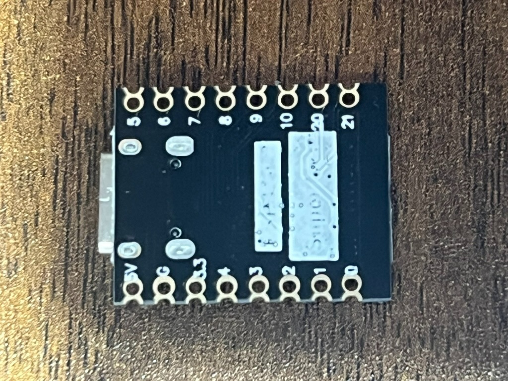 | 超小体积，背面丝印标注电源脚 `5V` / `G` / `3.3` 与 IO 脚 `0`~`10`、`20`、`21`。纯 BLE HID 输入与管理。 |
| **ESP32-S3 主控（可选）** | **ESP32-S3 SuperMini**（4 MB Flash）<br>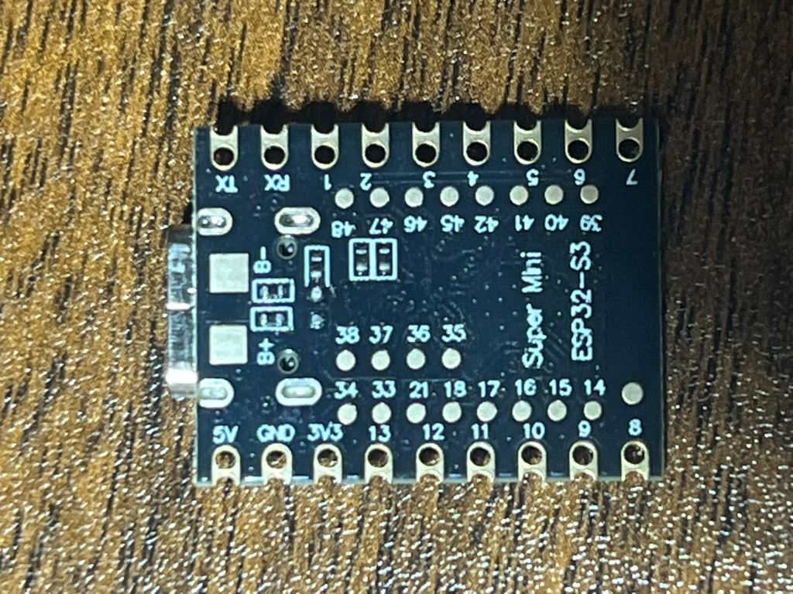 | 背面丝印标注 `5V` / `GND` / `3V3`、`TX`（GPIO43）/ `RX`（GPIO44）与数字脚 `1`~`13` 等。支持 USB + BLE 双模与深睡唤醒。 |
| **指纹模块（必需）** | **ZW111 半导体指纹模块（6 芯 JST 接口）**<br>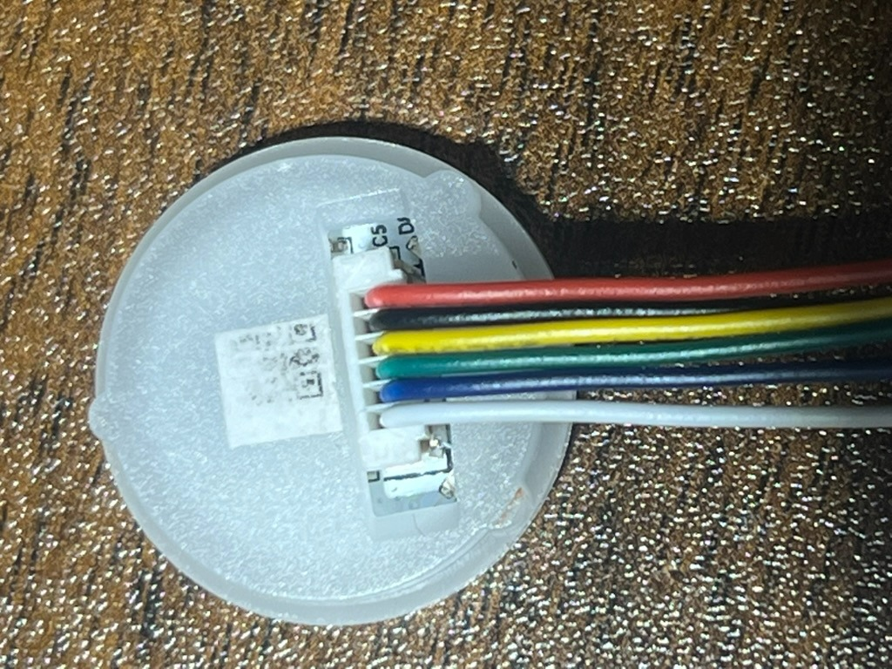 | 3.3V TTL UART（57600 波特率），带 100 枚模板存储与电容触摸唤醒输出。**实测线序自上而下为：红(6)、黑(5)、黄(4)、绿(3)、蓝(2)、白(1)**。 |
| **振动马达（可选项）** | **3 针扁平振动马达驱动模块（High 触发）**<br>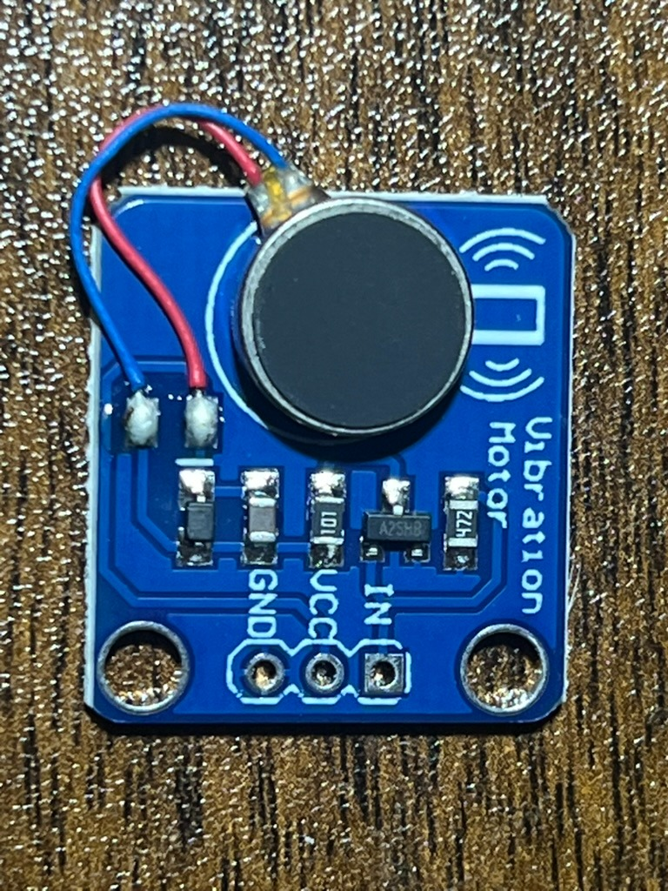 | 板载 `GND`、`VCC`、`IN` 三脚；**完全可选，不接不影响任何指纹识别、绿灯闪烁与宏输入功能**。 |

---

## 硬件接线

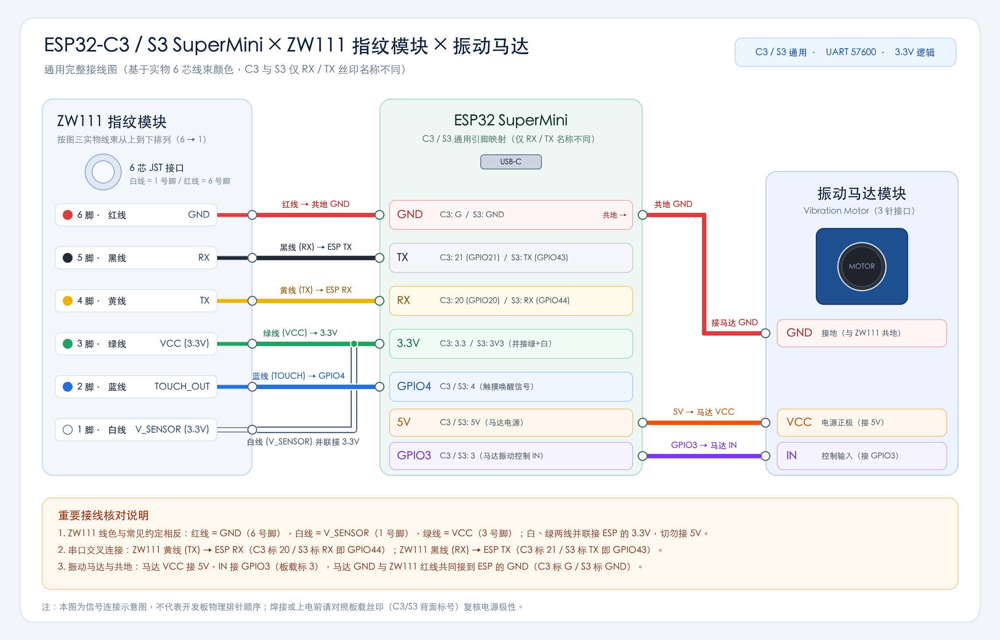

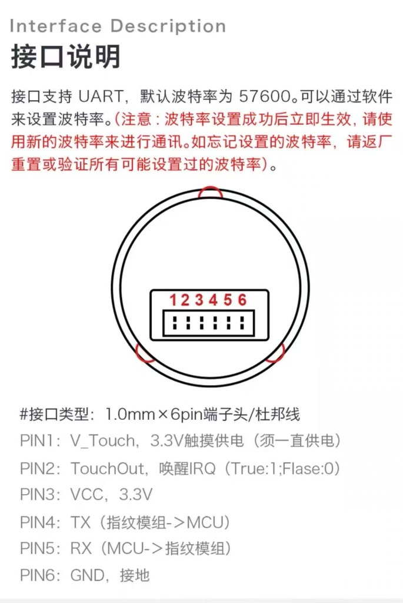

> **⚠️ 务必注意线色方向**：基于图三实物 6 芯线束实测，**白线为 1 号脚、红线为 6 号脚**（与常见“红正黑负”约定相反），焊接前请对照实物接口与板载丝印复核供电，**ZW111 严禁接入 5V**。

### 1. ZW111 指纹模块（6 芯，必需）

| 实物线序（图三从上到下） | 线色 | 模块功能 | ESP32-C3 引脚（丝印 / GPIO） | ESP32-S3 引脚（丝印 / GPIO） | 说明 |
| --- | --- | --- | --- | --- | --- |
| 6 脚 | **红线** | `GND` | `G` (`GND`) | `GND` | 共同地 |
| 5 脚 | **黑线** | `RX` | `21` (`GPIO21`) | `TX` (`GPIO43`) | **串口交叉：ESP TX → 模块 RX** |
| 4 脚 | **黄线** | `TX` | `20` (`GPIO20`) | `RX` (`GPIO44`) | **串口交叉：模块 TX → ESP RX** |
| 3 脚 | **绿线** | `VCC` | `3.3` (`3.3V`) | `3V3` (`3.3V`) | 模块主供电（3.3V） |
| 2 脚 | **蓝线** | `TOUCH_OUT` | `4` (`GPIO4`) | `4` (`GPIO4`) | 手指触摸唤醒信号 |
| 1 脚 | **白线** | `V_SENSOR` | `3.3` (`3.3V`) | `3V3` (`3.3V`) | 传感器供电，与绿线并接至同一 `3.3V` |

### 2. 振动马达模块（3 针，可选项）

- **不接马达时**：跳过下面 3 根线即可，设备工作完全正常。
- **选接马达时**：
  - `VCC` → ESP **`5V`**
  - `GND` → ESP **`GND`**（与 ZW111 红线共地接到同一个 `G` / `GND` 引脚）
  - `IN` → ESP **`GPIO3`**（C3 与 S3 板载丝印均为 **`3`**；注意 **`GPIO4` 是 ZW111 蓝线触摸脚，不要错接**）

---

## 软件界面与分步使用详解

### 第一部分：使用「ZW111 一键安装器 1.2.7」刷写固件

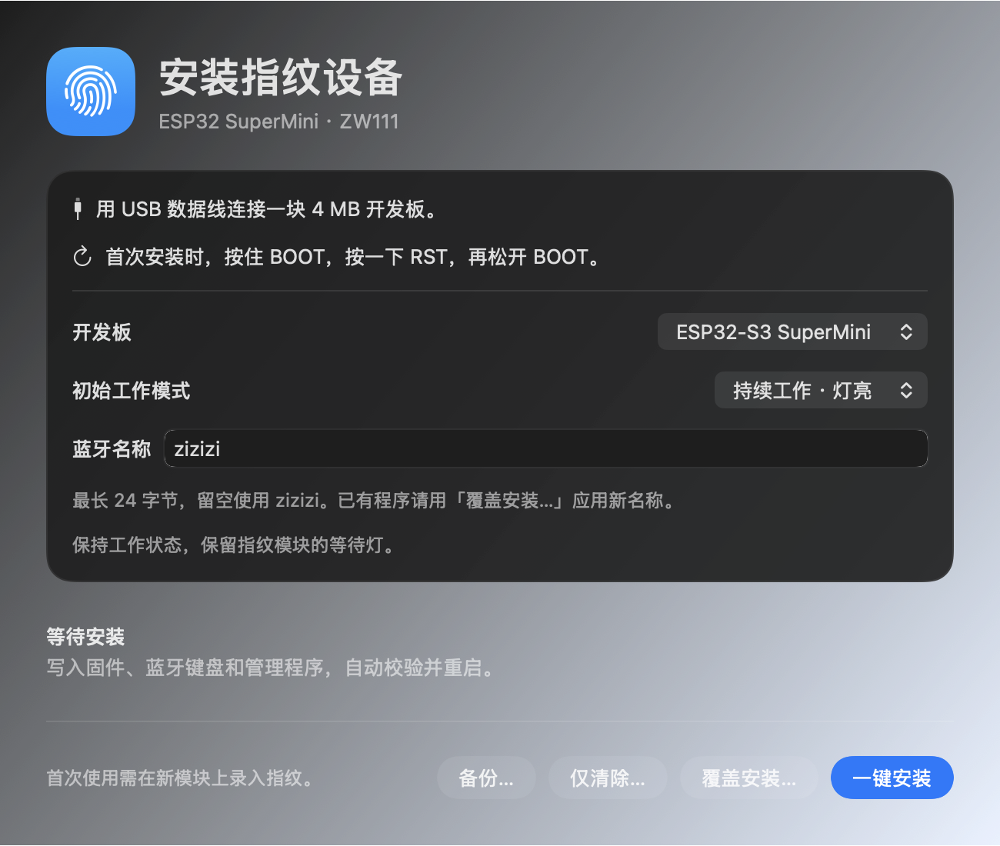

1. **连接开发板与进入下载模式**：用带数据传输功能的 USB-C 线把 ESP32-C3 或 ESP32-S3 连到 Mac；如果是全新空板首次刷写，按住开发板 **`BOOT`** 键不放，点按一下 **`RST`** 键，再松开 `BOOT`。
2. **界面各选项与按钮说明**：
   - **开发板**：选择你连接的型号（`ESP32-S3 SuperMini` 或 `ESP32-C3 SuperMini`）。
   - **初始工作模式**：选择刷入后的默认模式（S3 支持持续灯亮/灯关/轻度省电/深度省电；C3 支持持续工作/省电模式）。
   - **蓝牙名称**：自定义设备在 Mac 蓝牙里显示的名称（最长 24 字节 ASCII 字符，留空默认为 `zizizi`）。
   - **一键安装**：全新刷写完整固件与初始配置；若板内已有旧配置，提示使用 **「覆盖安装...」** 更新固件及应用新的蓝牙名称。
   - **仅清除...**：仅擦除开发板整片闪存（不写入新固件）。
   - **备份...**：弹出保存对话框，将当前开发板整片闪存内容导出为 `.bin` 备份文件。
3. **完成蓝牙配对**：刷写自动校验并重启后，打开 Mac **系统设置 → 蓝牙**，连接名为 `zizizi`（或你自定义的名称）的蓝牙键盘。

---

### 第二部分：使用「指纹管理器 1.0.7」日常配置

左侧导航栏包含 3 个功能页面和 1 个快捷操作：
- **我的指纹** / **输入宏** / **设置** / **↻ 重启设备**（点击即通过当前 USB 或蓝牙发送重启指令）。
- 左下角显示当前连接状态（`ZW111 未连接` / `● ZW111 已连接 · USB` / `● ZW111 已连接 · 蓝牙`），以及 **浅色 / 深色** 界面外观切换。
- 右下角 **停止当前操作** 可随时中断正在进行的蓝牙扫描、刷新或录入流程。

#### 1. 「我的指纹」页面

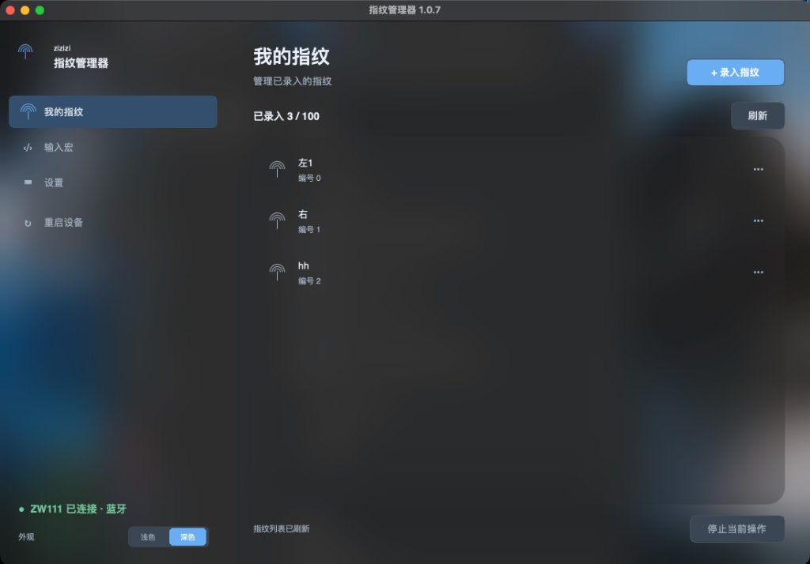

- **刷新**：读取设备指纹库参数与已占用编号列表（顶部计数会更新为 `已录入 X / 100`，底部显示 `模块中 X / 100 枚 · 新录入需 8 次按压 · 名字保存在这台 Mac`）。连接 S3 时若插着 USB 会优先通过有线管理；C3 则通过蓝牙管理。
- **+ 录入指纹**：
  1. 点击后先输入这枚指纹的备注名称（名字保存在本机 Mac 上）。
  2. 根据顶部与弹窗提示按下同一根手指并抬手，共采集 **8 次**，随后自动合并特征并保存到模块闪存。
  3. 如果某次采集未完成或特征提取失败，会弹出重试框，按提示松开手指点 **Retry** 即可继续当前采样次数（只要指纹模块不断电，无需重头再来）。

  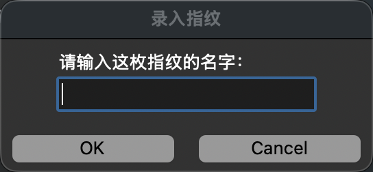 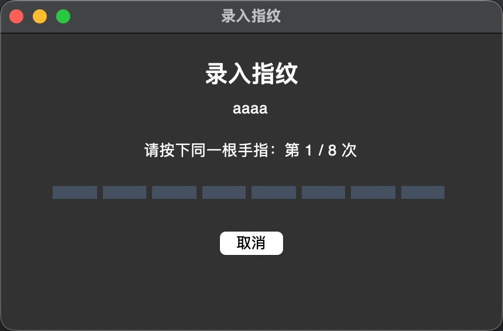

- **修改名称 / 删除指纹**：刷新读取列表后，点击指纹条目右侧的 **`•••`** 菜单按钮，即可弹出 **「修改名称」**（仅改本机 Mac 备注）或 **「删除指纹」**（从模块闪存中永久删除）。

#### 2. 「输入宏」页面

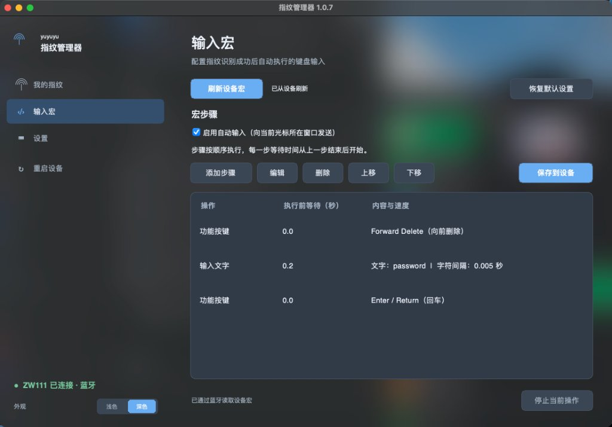

- **刷新设备宏**：从已连接的 S3（优先 USB）或 C3（蓝牙）读取当前保存在板内的宏配置。
- **启用自动输入**：勾选后，识别指纹成功才会发送下列动作序列；取消勾选则只亮绿灯/振动但不向电脑发送按键。
- **动作编排按钮**：
  - **添加步骤 / 编辑 / 删除 / 上移 / 下移**：自由添加或调整每一步动作，支持 **输入文字**（可设输入前等待秒数及每个字符的打字间隔，适合防止系统锁屏界面丢字）、**功能按键**（如 `Forward Delete`、`Backspace`、`Enter`、`Tab`、`Escape`、方向键、F1~F12 等）。
- **恢复默认设置**：需两次确认，自动写入解锁常用预设（`Forward Delete → 等待 0.2s → password → Enter`），之后再将 `password` 改为你的实际密码即可。
- **保存到设备**：将当前宏写入设备并立即自动**读回校验**，确保保存成功。

#### 3. 「设置」页面与「重启设备」

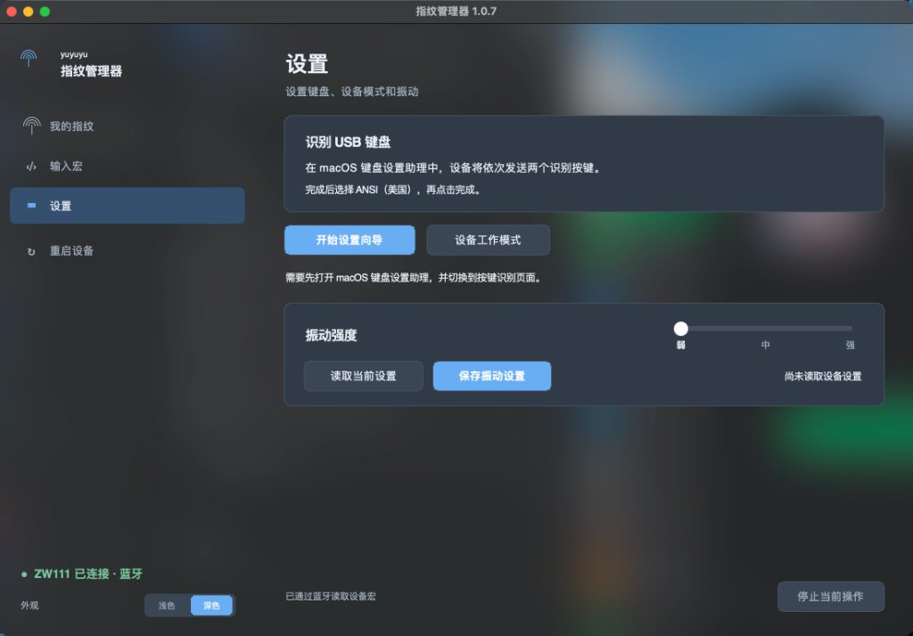

- **开始设置向导**（需插着 USB 线）：当 Mac 连接新蓝牙键盘后弹出「键盘设置助理」时，先切换到助理的按键识别页面，再点此按钮依次发送两个识别按键，完成后选择 **ANSI（美国）**。
- **设备工作模式**：弹窗查看并切换当前开发板的工作模式：
  - **S3**：持续工作·灯常亮 / 持续工作·灯关闭 / 轻度省电 / 深度省电。
  - **C3**：持续工作（不省电） / 省电模式（降频）。
- **振动强度**：通过 **弱 / 中 / 强** 三档滑块与 **读取当前设置** / **保存振动设置**，读取和调整匹配成功时的马达振动时长（0.1s / 0.2s / 0.3s，不接马达可忽略）。
- **↻ 重启设备**（左侧栏设置下方）：无论当前处于 USB 连接还是纯蓝牙供电模式，均可一键安全重启开发板。

---

## 3D 打印外壳模型（SolidWorks / STEP）

外壳模型存放于 [models/](models/) 目录，均采用抽拉式底盖与独立分区设计（主控区 / 指纹模块圆孔位 / 可选振动马达槽位），同时提供通用 `.STEP` 文件和 SolidWorks 源文件 `.SLDPRT` 方便二次修改尺寸：

| 适用开发板 | 通用格式（直接切片/通用 CAD） | SolidWorks 源文件（可编辑特征） |
| --- | --- | --- |
| **ESP32-C3 版外壳** | [models/c3.STEP](models/c3.STEP) | [models/c3.SLDPRT](models/c3.SLDPRT) |
| **ESP32-S3 版外壳** | [models/s3.STEP](models/s3.STEP) | [models/s3.SLDPRT](models/s3.SLDPRT) |

### 打印建议（四面绒毛表面）

- 推荐在切片软件（如 Bambu Studio / OrcaSlicer，搭配 `0.20mm` 层高、PLA Basic 耗材及纹理 PEI 打印板）中，对**外壳的四个外侧面开启「绒毛表面（Fuzzy Skin）」**，可以明显弱化 3D 打印层纹并提升防滑与磨砂质感（顶/底接触面与内部导轨保持光滑，避免影响抽拉底盖配合精度）。

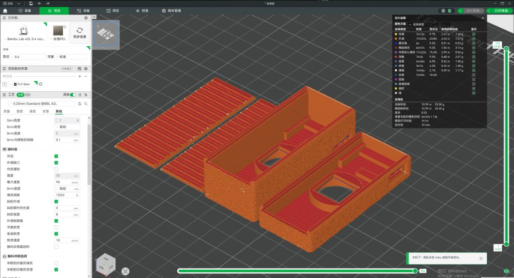

---

## 实物展示

| 外观与四面绒毛质感对比（S3 版 / C3 版） | 内部走线与抽拉底盖装配图 |
| --- | --- |
| 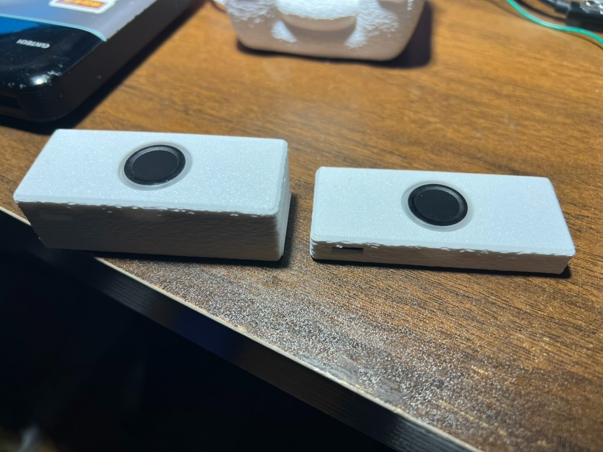 | 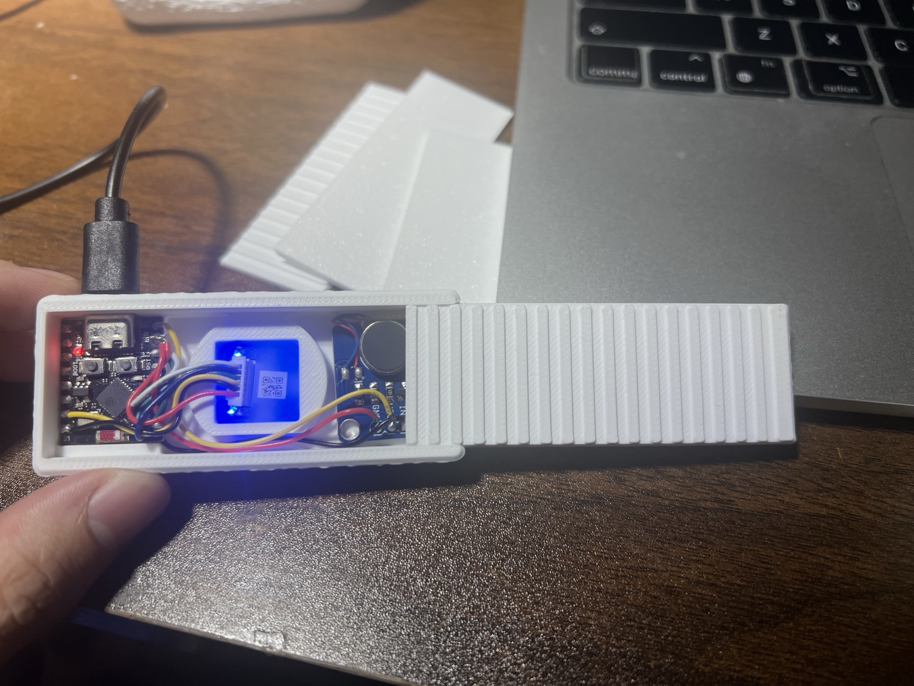 |

---

## ⚠️ 安全提示

- 输入宏（含文字内容）以**明文**形式存储在开发板闪存 `/macro.json` 中，请勿存入高敏金融密码或重要私钥，建议仅用于电脑本地开机/解锁口令等快捷场景。

---

## 校验文件（SHA-256）

```text
55ad007f5fd5c9faead8ee259984ba8c1ccd1e6958c81a32e514d9e88421e12b  ZW111-Installer-1.2.7-ForMac.zip
352ea79144d344b460b6ab37e5c5b558d6f106510a6fd14a7f3de556e92627ab  ZW111-Manager-1.0.7-ForMac.zip
```
