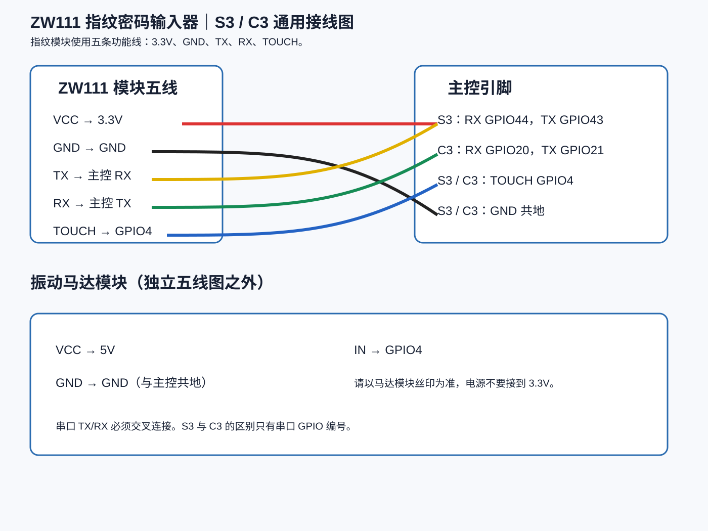

# 指纹密码输入器（ZW111 Fingerprint Keyboard）

ZW111 指纹模块 + ESP32-S3 / ESP32-C3 的指纹宏键盘。验证指纹后，设备通过 USB 或蓝牙 HID 输入你配置的文字、等待和功能键。

## 下载新版

请进入 [Releases](https://github.com/GeofforyTsang130/zw111-fingerprint-keyboard/releases) 下载最新版。主目录只保留源码、接线图和说明，旧版安装包已移除。

当前版本是 **安装器 1.2.7** 和 **指纹管理器 1.0.7**。

## 一、准备材料

- ESP32-S3 SuperMini 或 ESP32-C3 SuperMini
- ZW111 指纹模块
- 3.3V 供电和可传输数据的 USB 线
- 杜邦线或可靠焊接连接

模块和开发板必须共地。接线前断电。不要把 5V 接到模块的 3.3V 端。

## 二、S3 接线



| ZW111 | ESP32-S3 |
| --- | --- |
| VCC / 3.3V | 3V3 |
| GND | GND |
| TX | GPIO44（S3 接收） |
| RX | GPIO43（S3 发送） |
| 触摸输出，可选 | GPIO4 |

串口必须交叉连接。模块 TX 接开发板 RX，模块 RX 接开发板 TX。

C3 使用以下串口和触摸引脚。模块 TX → GPIO20，模块 RX → GPIO21，触摸输出 → GPIO4。C3 振动输出使用 GPIO3。

## 三、第一次安装固件

1. 打开 Releases，下载 **ZW111 一键安装器 1.2.7**。
2. 解压后将 App 放入“应用程序”。
3. USB 连接开发板，选择 S3 或 C3、工作模式和蓝牙名称。
4. 首次刷写时按住 BOOT，按一下 RST，再松开 BOOT。
5. 点击“一键安装”，等待完成后重新插拔 USB。
6. 在 macOS 蓝牙设置中配对设备。默认蓝牙名称是 `zizizi`。

覆盖安装会重写设备程序、宏和蓝牙配对信息。指纹模板仍保存在 ZW111 模块中。需要保留旧设备内容时，先使用安装器的“备份…”功能。

## 四、管理指纹和宏

1. 下载并打开 **指纹管理器 1.0.7**。
2. S3 优先使用 USB 管理，C3 使用蓝牙管理。
3. 在“我的指纹”中刷新、录入、命名或删除指纹。录入时按界面提示完成多次采样。
4. 在“输入宏”中添加文字、等待和功能按键，保存后用文本编辑器测试。
5. 在“设置”中切换工作模式、重启设备。新版 C3 可以读取和设置弱、中、强三档振动。

宏会以明文保存在设备上，请不要保存重要账号密码。

## 五、常见问题

**设备没有出现**  
检查 USB 线是否支持数据，确认模块供电为 3.3V，并检查 GND 是否共地。

**刷写失败**  
重新按住 BOOT、点按 RST，再松开 BOOT。换一根数据线并关闭占用串口的程序。

**蓝牙搜不到设备**  
在 macOS 蓝牙设置中忽略旧的 `zizizi` 设备，重启开发板后重新配对。

**录入过程中失败**  
保持手指覆盖区域稳定。模块断电或重启后，从第一次采样重新开始。

## 六、校验文件

```text
ecb12116825ec8eb63f277edd732953ca1f6dfebe2e93188d2cd2284ffaac0f1  指纹管理器-1.0.7.zip
a2579fdb8d85b7414f96b5ebaa565c7fa191a06451f58db8a368d371a52aeb53  ZW111-Mac-Installer-1.2.7.zip
```

终端运行 `shasum -a 256 文件路径` 校验下载是否完整。
